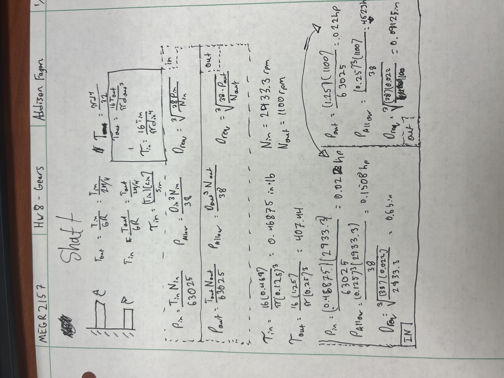
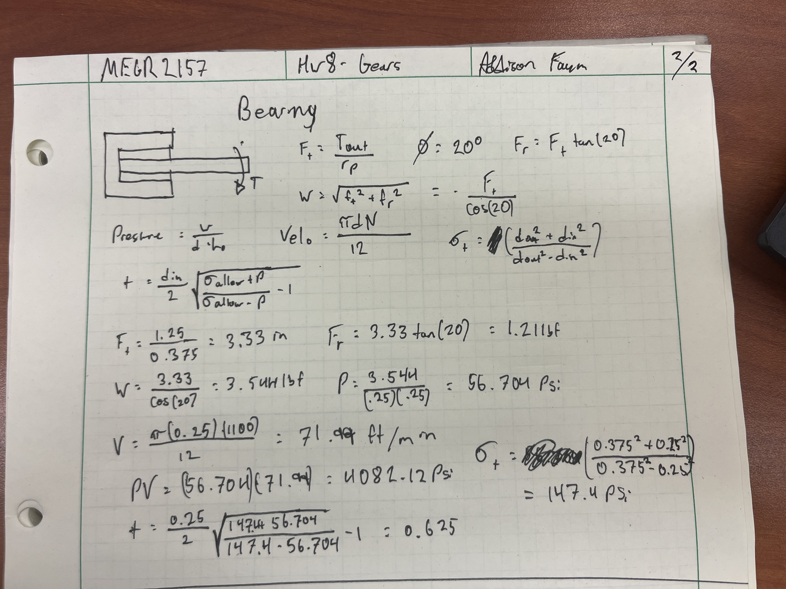
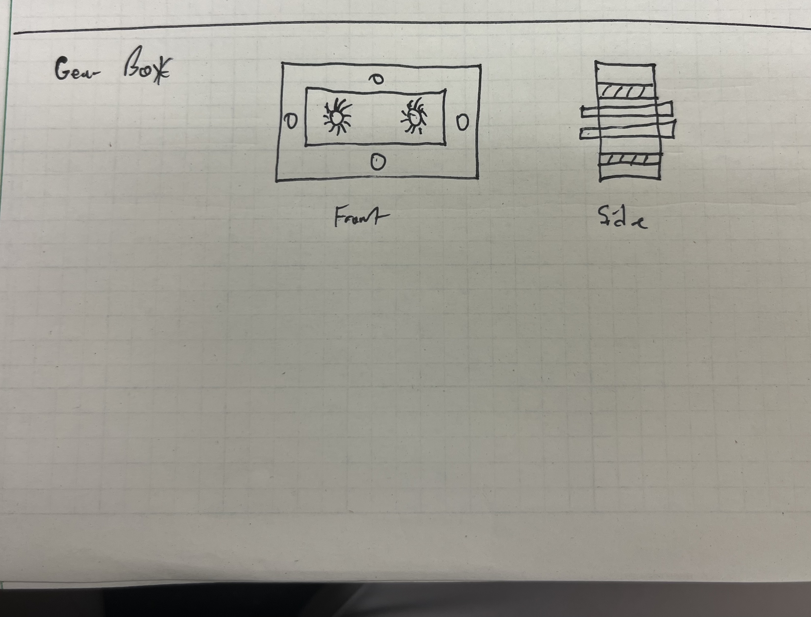

# A8 – Gears

## Objective
The primary objective of this project is to develop a fully functional, modular gearbox engineered for straightforward assembly and disassembly. Key technical goals include analyzing and sizing the input and output shafts for structural strength, designing matched journal bearings for reliable shaft support, and engineering an enclosure with proper internal clearances and secure fastening. The final design will be modeled using Solidworks, supported by thorough engineering documentation covering detailed calculations, conceptual sketches, and critical lessons learned throughout the process.

## Shaft Drawing and Calculations

## Bearing Drawing and Calculations

## Gearbox Drawing

## Gearbox CAD
I picked alloy steel because it's super common and pretty much what every industry uses. For the box, I made the base 3 inches long by 2 inches tall, and then I just extruded it back 3 inches so it would fit the longest shaft in the model.

.png)

.png)

.png)

## Gearbox Part Download

## Downloaded Parts and Links to Purchase
Bolt - https://www.mcmaster.com/91251A102/ 

Bearing Sleeve Little Hole - https://www.mcmaster.com/6391K111/

Bearing Sleeve Big Hole - https://www.mcmaster.com/6391K136/

Big Gear - https://www.mcmaster.com/6832K45/

Shaft - https://www.mcmaster.com/1327K113/

Little Gear - https://www.mcmaster.com/7880K17/

Small Shaft - https://www.mcmaster.com/1327K93/

## Conclusion 
In this assignment, I learned how to calculate torque (we haven't gone over it in solids yet) and how easy it is to import files from manufacturer’s websites, so I don't need to design and machine every part myself. Overall, the CAD was the easiest part of this assignment and took me 2 hours, but the calculations took closer to 4 hours because I haven't worked with these calculations before. So, in total, this took me 6 hours to complete

