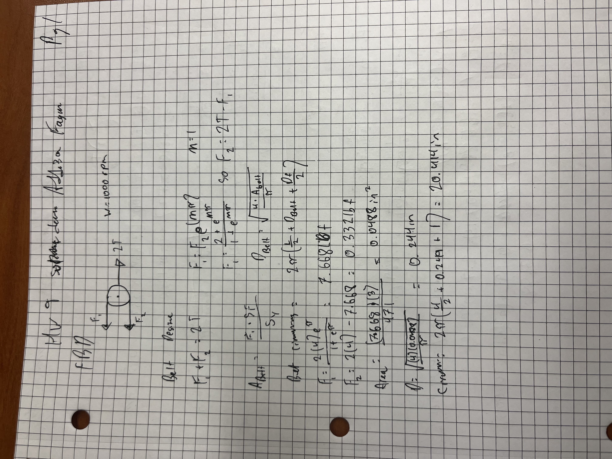
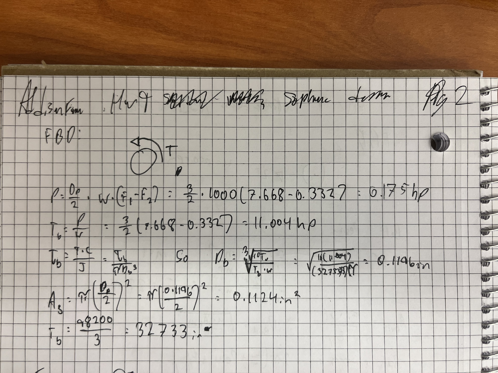
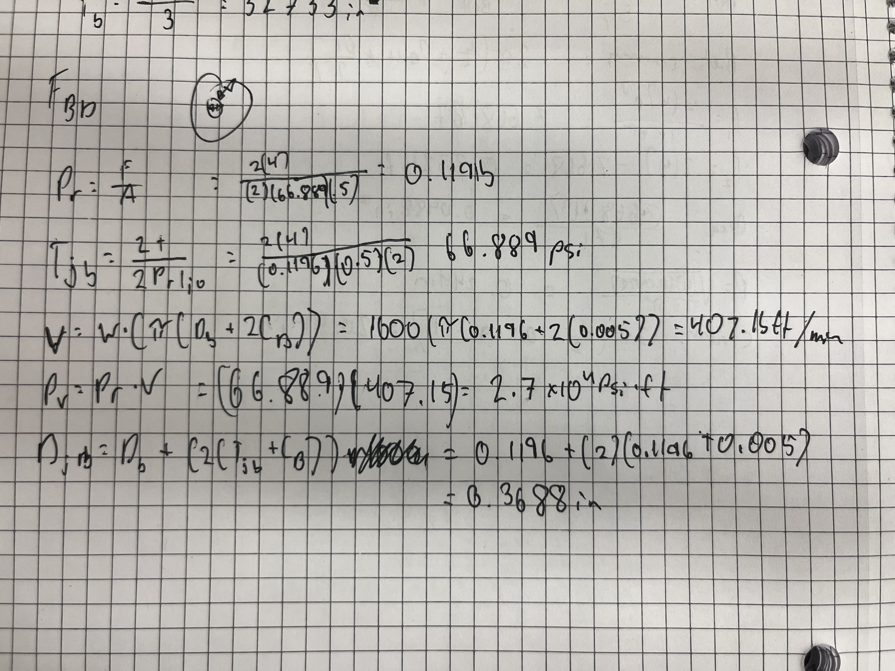
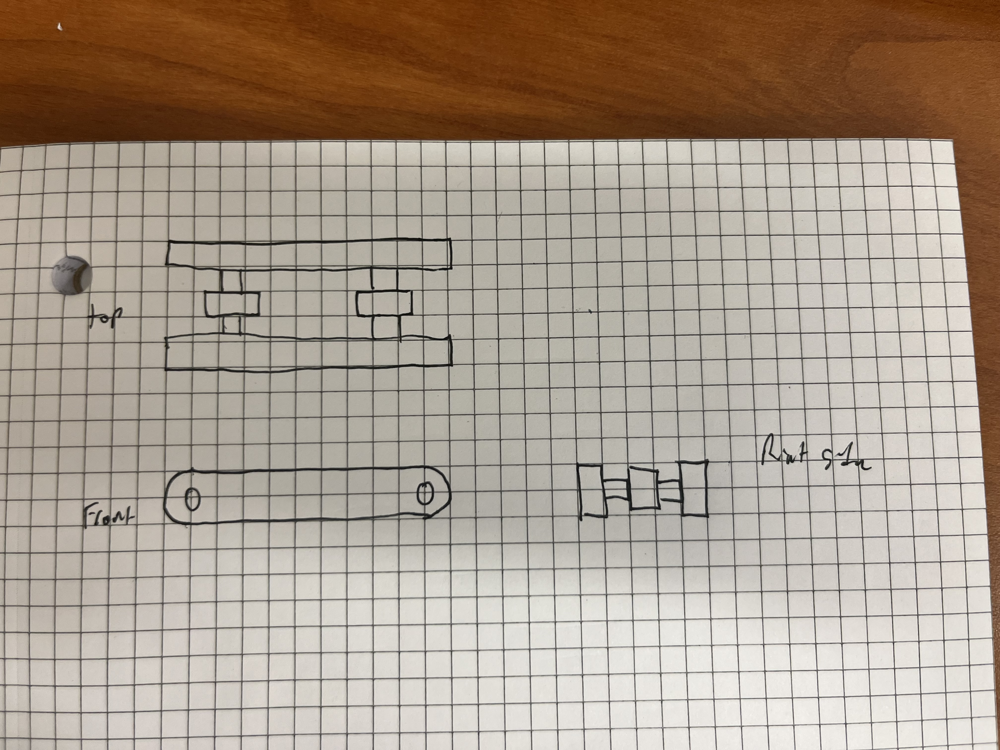

# A9 – Pulleys

## Objective
The goal of this project is to design and analyze a parallel axis pulley drive system that transfers power across a 4 to 6 inch center distance while maintaining at least a 3.0 safety factor. To make sure everything holds up under load, I'll be calculating tight and loose side tensions to size a polyurethane belt, finding the minimum safe shaft diameter using 1060 hardened steel, and checking PV limits to select the right journal bearing material. From there, I'll package the components into a rigid support frame and pull everything together in CAD alongside the free body diagrams, hand calculations, and key takeaways from the build.

## Belt FBD and Math

## Shaft FBD and Math

## Bearing FBD and Math

## Part Multiveiw

## Communicate

